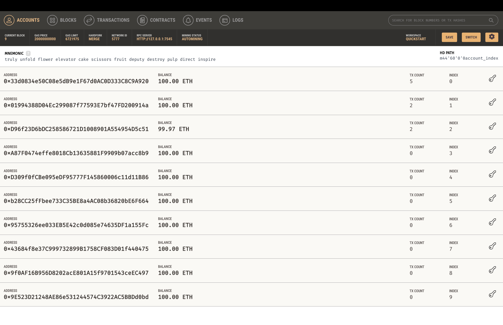
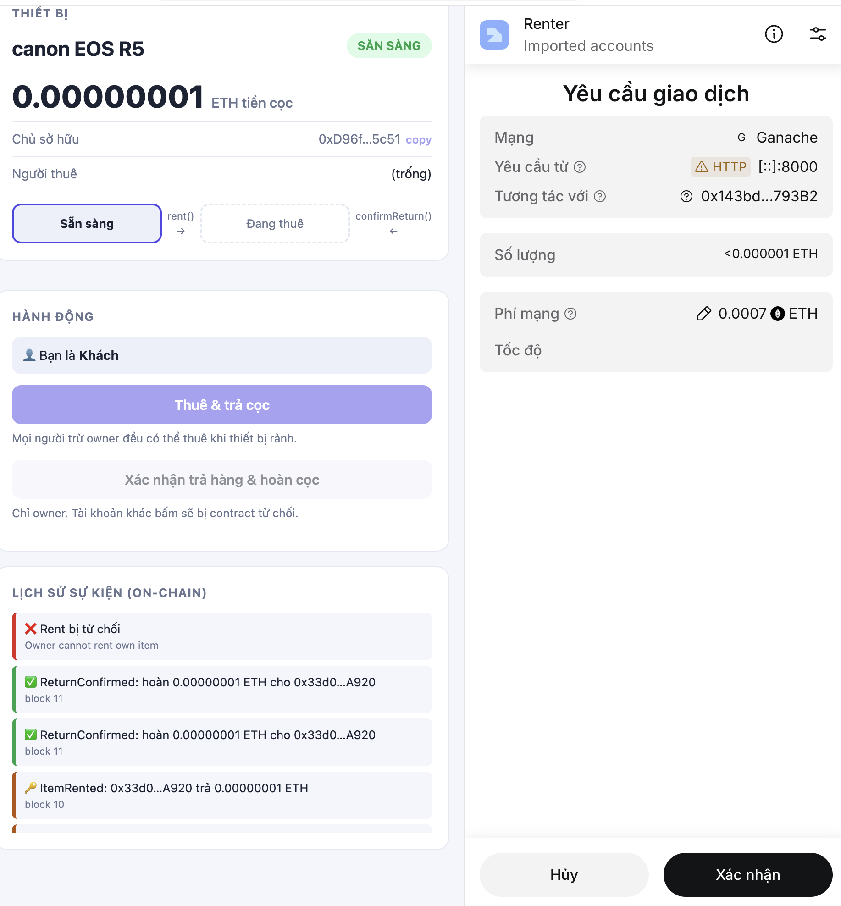
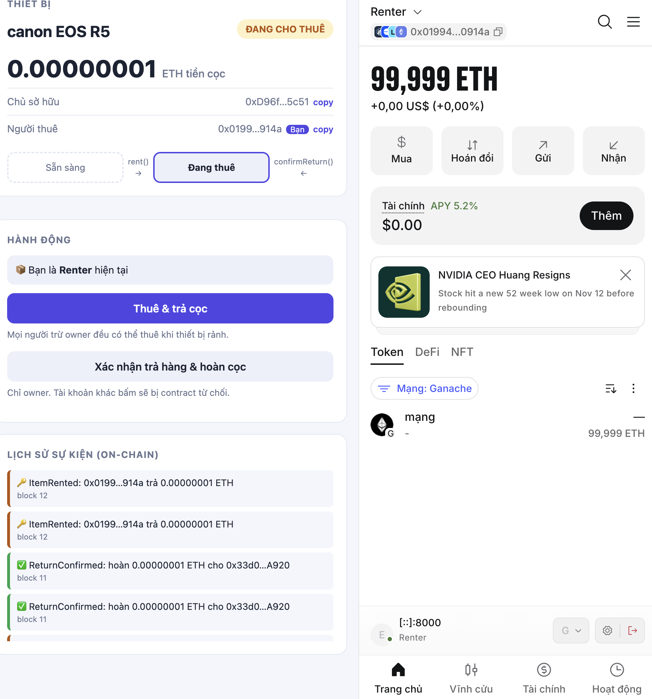
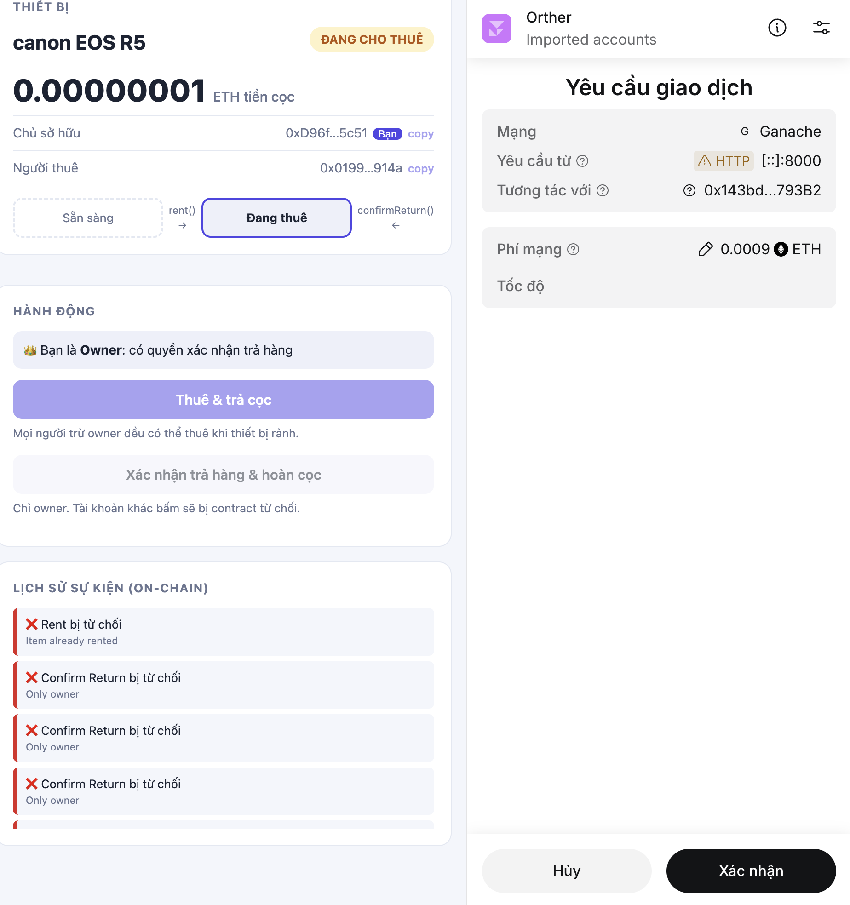
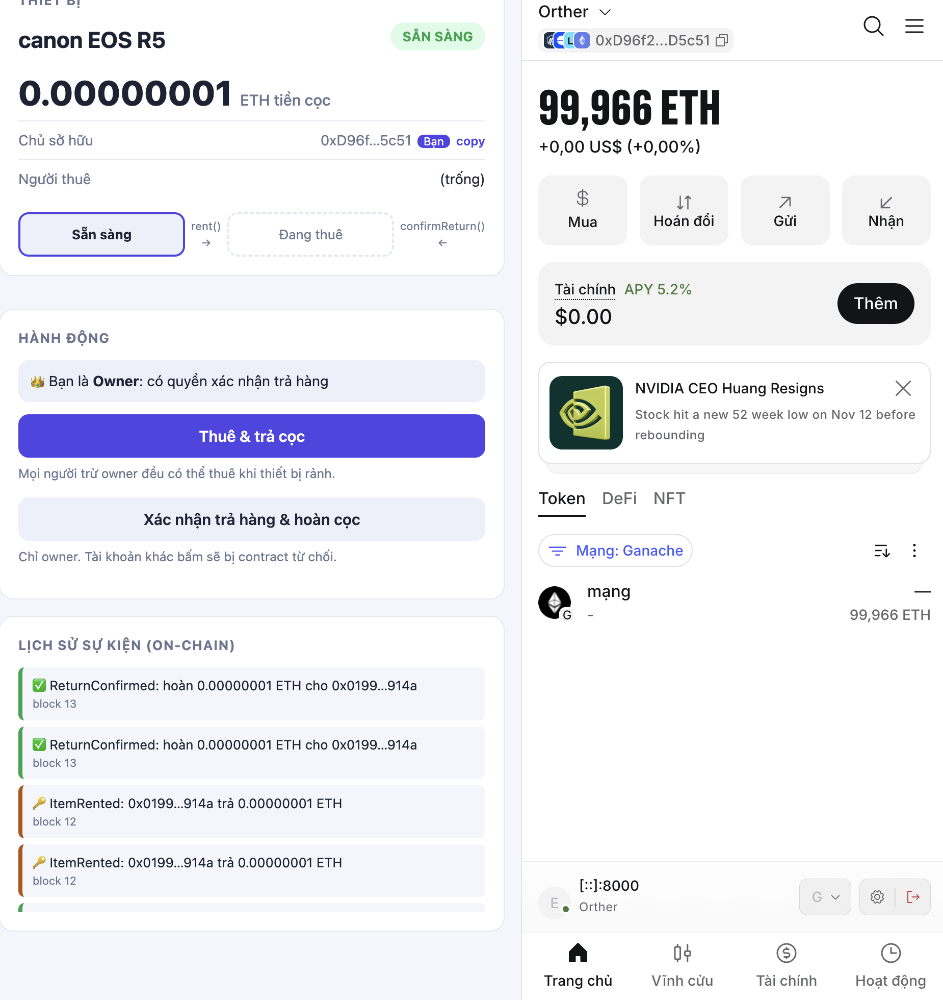

# Equipment Rental Deposit

- Course: DS 441 A - Blockchain: Theory & Practices
- Student: Nguyễn Hữu Tâm | ID: 29211134854
- Project: Equipment Rental Deposit

## Mô tả
Smart contract quản lý tiền cọc (test Ether) cho **một** thiết bị. Owner đăng thiết bị với tiền cọc cố định; renter trả cọc để thuê; chỉ owner xác nhận trả hàng, khi đó contract hoàn cọc cho renter và giải phóng thiết bị.

## Quy tắc trong contract (không chỉ ở giao diện)
- `rent()`: chỉ khi thiết bị đang rảnh, người gọi không phải owner, và gửi đúng bằng tiền cọc.
- `confirmReturn()`: chỉ `owner` (modifier `onlyOwner`), chỉ khi thiết bị đang được thuê.
- Events: `ItemListed`, `ItemRented`, `ReturnConfirmed`.

## Cấu trúc dự án
```
contracts/EquipmentRental.sol   # smart contract
index.html                      # giao diện Web3 (ethers.js v6)
deploy_and_test.py              # deploy + test tự động (web3.py)
docs/                           # ảnh minh chứng
```

## Yêu cầu
- Ganache GUI, Remix IDE, VS Code, MetaMask, Python 3.10+
- `pip install web3 py-solc-x`
- Chỉ dùng tài khoản và ETH test của Ganache. Không dùng private key hay tiền thật.

## Cấu hình mạng Ganache / MetaMask
| Tham số | Giá trị |
|---|---|
| RPC URL | http://127.0.0.1:7545 |
| Chain ID | 1337 (Network ID 5777) |
| Currency | ETH |
| Hardfork | Merge (EVM version: `paris`) |

Tài khoản demo (import từ Ganache vào MetaMask):
| Vai trò | Ganache index | Địa chỉ |
|---|---|---|
| Owner | 0 | ĐIỀN |
| Renter | 1 | ĐIỀN |
| Other | 2 | ĐIỀN |

Contract đã deploy: `ĐIỀN-ĐỊA-CHỈ-CONTRACT`

## Các bước thực hiện

### 1. Deploy bằng Remix
- Compile với Solidity `0.8.20`, EVM version `paris`.
- Deploy & Run → Environment: **Browser Extension → MetaMask** (mạng Ganache, tài khoản Owner).
- Tham số constructor: `"Canon EOS R5"`, `1000000000000000000` (1 ETH).

### 2. Chạy giao diện
```
cd equipment-rental
python3 -m http.server 8000
```
Mở http://localhost:8000 → **Kết nối ví** → dán địa chỉ contract → **Tải**.

### 3. Test tự động
```
python3 -m venv .venv
source .venv/bin/activate
pip install web3 py-solc-x
python deploy_and_test.py
```
Script tự deploy một contract riêng lên Ganache và kiểm tra 6 điều kiện.

## Kết quả demo

### Ganache


### 1. Renter thuê thiết bị


### 2. Giao dịch thành công: thiết bị chuyển sang ĐANG CHO THUÊ


### 3. Tài khoản Other thuê lần hai


### 4. Giao dịch bị từ chối: "Item already rented"


<!-- Bỏ chú thích khi đã có ảnh:

### 5. Renter xác nhận trả hàng: bị từ chối ("Only owner")


### 6. Owner xác nhận trả hàng: hoàn cọc, thiết bị SẴN SÀNG


### 7. Số dư Renter sau khi nhận hoàn cọc


### 8. Giao dịch trên Ganache


### 9. Kết quả script deploy_and_test.py


-->

## Giải thích kết quả
- **Giao dịch thành công:** Renter gọi `rent()` với đúng 1 ETH, contract lưu `renter`, đặt `available = false` và phát event `ItemRented`.
- **Bị từ chối (thuê lần hai):** `require(available)` trong `rent()` thất bại vì thiết bị đã có người thuê, nên giao dịch của tài khoản Other bị hủy và không mất tiền cọc.
- **Bị từ chối (sai quyền):** `confirmReturn()` dùng modifier `onlyOwner`, kiểm tra `msg.sender == owner` ngay trong contract. Renter gọi sẽ bị từ chối dù giao diện cho phép bấm nút.
- **Hoàn cọc:** khi owner xác nhận, contract cập nhật `renter` và `available` **trước**, rồi mới chuyển ETH (mẫu checks-effects-interactions, chống reentrancy). Renter nhận lại đúng 1 ETH, số dư chỉ thiếu phí gas của lần thuê.

## Nguồn tham khảo / hỗ trợ
- Mã nguồn được hỗ trợ soạn thảo bởi Claude (Anthropic); tôi đã đọc hiểu, chỉnh sửa và kiểm thử.
- ethers.js v6 (cdnjs), web3.py, py-solc-x, Remix IDE, Ganache.